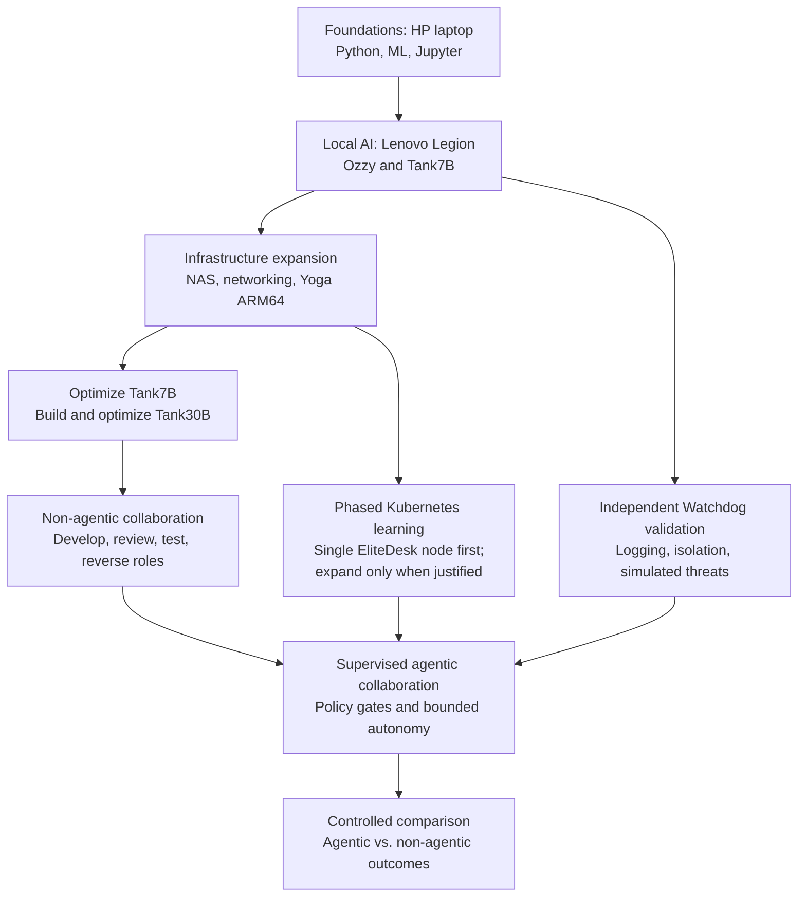

# My Personal AI Infrastructure Lab
**Foundation and Evolution | A living engineering project**

This repository documents my hands-on journey in artificial intelligence, machine learning, Linux, networking, security, and infrastructure engineering. The goal is not simply to accumulate hardware: it is to build, understand, measure, and improve a locally operated AI environment, one validated stage at a time.

The lab began with Python coursework and Jupyter notebooks on an HP laptop. As the experiments outgrew that machine, I moved to a Lenovo Legion to develop local AI assistants and coding models. The next stages add shared storage, a Windows ARM64/WSL2 development platform, independent security monitoring, and phased Kubernetes experimentation.

This repository is a **living record**, not a claim that the entire system is finished. It documents why each change was made, what was tested, what failed, and what comes next.

## Engineering Principles

1. **Optimize before adding autonomy.** Establish reliable model baselines before introducing agentic workflows.
2. **Prove security boundaries.** Test monitoring, containment, and shutdown rather than assuming they work.
3. **Measure improvements.** Compare models and workflows using repeatable tasks and recorded results.
4. **Scale when justified.** Add hardware and orchestration capabilities incrementally as requirements and budget allow.
5. **Preserve the learning trail.** Record experiments, corrections, and design tradeoffs alongside successes.

## Development Roadmap

The diagram shows intended dependencies. Watchdog testing and infrastructure preparation can proceed in parallel.



### Status Snapshot — November 1, 2026

| Workstream | Current status | Next evidence or milestone |
|---|---|---|
| HP learning environment | Foundational work completed; Windows/WSL Ubuntu system retained for Linux practice and health monitoring | Continue monitoring exercises and document results |
| Legion / Ozzy / Tank7B | Working local development environment | Optimize Tank7B and record reproducible evaluations |
| UGREEN NAS and 2.5 GbE network | NAS and network equipment acquired/initially deployed; eight-port switch acquired | Validate storage shares, throughput, backups, and recovery |
| Lenovo Yoga RTX Spark | Delivered; Windows ARM64, CUDA Toolkit, Ubuntu WSL2, VS Code WSL connection, and Docker `hello-world` completed | Verify GPU acceleration inside WSL2 and benchmark local workloads |
| Tank7B Watchdog | Heartbeat-triggered container shutdown demonstrated; further validation pending | Confirm persistent failure logs, isolation, and bypass resistance |
| Dedicated Watchdog host | Lenovo ThinkCentre Tiny acquired and assigned to independent Watchdog services outside Kubernetes | Install/configure host and validate cross-machine supervision |
| Tank30B | Planned; Yoga software foundation progressing | Deploy, optimize, and benchmark the model |
| Kubernetes learning node | HP EliteDesk 800 G5 Mini acquired and assigned as initial single-node host; cluster not yet deployed | Install Ubuntu/Kubernetes and test pods, limits, and recovery |
| Non-agentic model collaboration | Planned | Run controlled developer/reviewer role-swap evaluations |
| Agentic orchestration | Future phase, gated on security validation | Repeat comparable evaluations with bounded autonomy |

**Status convention:** “Acquired,” “configured,” “validated,” and “planned” describe different stages. A successful software installation is not the same as verified workload performance.

## Validated Milestones

### November 1, 2026 — Yoga ARM64 Linux and Container Foundation

- Ubuntu launched successfully under **WSL2** on the Lenovo Yoga running Windows ARM64.
- **VS Code connected to the WSL Ubuntu environment.**
- **Docker executed the official `hello-world` container successfully**, including retrieval of the ARM64 image and execution through the Docker daemon.
- This validates a basic ARM64 container workflow; it **does not yet establish CUDA access inside WSL2, GPU-enabled container execution, or Tank30B performance**.

Reproduction check (in the configured Docker environment):

```bash
docker run hello-world
```

Expected evidence: the container prints **“Hello from Docker!”**. Record platform, versions, and test output when repeating this check.

### Earlier Validated Security Milestone — Tank7B Watchdog

A Tank container shut down when the Watchdog heartbeat stopped. Persistent failure logging, cross-machine monitoring, and additional adversarial simulations still require documented retesting.

## Infrastructure: From Laptop to Mini Data Center

### Phase 1 — HP Laptop: Learning Foundation

My initial HP laptop supported Python programming, machine learning fundamentals, Jupyter notebooks, and early model experiments.

It remains useful as a Windows/WSL Ubuntu system for Linux practice and overall lab health monitoring.

The dedicated Watchdog role is moving to a separate mini-PC.

### Phase 2 — Lenovo Legion: Local Model Development

- AMD Ryzen 7 processor
- NVIDIA RTX 5060 GPU (8 GB VRAM)
- 48 GB RAM
- Docker, local model runtimes, Jupyter, and SearXNG

The Legion remains the primary development and optimization machine for Tank7B, along with work on Ozzy, coding experiments, retrieval, and security tooling.

### Phase 3 — Storage, Networking, and Larger-Model Hardware

**Lenovo Yoga RTX Spark (delivered October 30, 2026):**

NVIDIA N1-based ARM64 platform, 64 GB unified LPDDR5X memory, 1 TB SSD, and Windows ARM64.

CUDA Toolkit 13.4 is installed.

Ubuntu WSL2, VS Code integration, and a basic Docker ARM64 container test were verified November 1.

The next steps are GPU/CUDA validation inside WSL2, model runtime setup, and controlled Tank30B testing.

Hardware presence and CUDA Toolkit installation alone do not prove GPU acceleration is available to a given workload.

**UGREEN NASync DXP4800:**

Four-bay NAS with two 8 TB Seagate IronWolf drives in a mirrored configuration for lab storage.

Planned validation includes shared folders, data integrity, access controls, backup, and recovery.

RAID mirroring is not a substitute for an independent backup.

Separate personal storage may be added later.

**Networking:**

2.5 GbE switching, Cat 6 cabling, and shared storage access form the lab network.

An eight-port 2.5 GbE switch has been acquired for expansion; connection changes and performance tests will be documented as performed.

UPS and power-management improvements remain part of the operational roadmap.

### Phase 4 — Kubernetes and Independent Monitoring

The initial Kubernetes learning target is **one HP EliteDesk 800 G5 Mini** running Ubuntu.

The first exercises will cover installation, pods, scheduling fundamentals, resource limits, basic service behavior, and recovery tests.

Additional worker nodes will be introduced **only when distributed workloads or experiments justify them**.

Kubernetes distributes workloads; it does not combine separate machines' RAM or VRAM into one pooled memory space.

Security supervision is intentionally **outside Kubernetes**.

The **Lenovo ThinkCentre Tiny** has been acquired and designated as the independent host for separately configured Watchdog services.

The HP laptop continues as a general health-monitoring and Linux-practice machine.

The dedicated Watchdog host has **not yet been reported as deployed or cross-machine validated**.

A separate machine alone is not a security guarantee.

Watchdog must have independent credentials, narrowly scoped control of supervised workloads, protected logs, and a tested shutdown path.

Each Tank host must fail closed if its required Watchdog supervision becomes unavailable.

## Local AI Projects

### [Ozzy — Local AI Assistant](https://github.com/curriemark63-byte/Ozzy_Project)

A local-first assistant built around a Mistral 7B model, retrieval-augmented answers, and self-hosted SearXNG search.

Ozzy established practical experience with local inference, retrieval, Docker, and debugging.

### [Tank — Local Coding Assistant](https://github.com/curriemark63-byte/Tank_Coding_Agent)

Tank7B uses Qwen 2.5 Coder 7B through Ollama.

It currently supports **Code**, **Teach**, and **Engineering** modes, along with self-hosted technical search.

Published experiments include prime-number coding, sensor drift, anomaly detection, and power-monitoring exercises.

**Tank is not yet an autonomous agent.**

Its model performance and security foundations are being developed and tested before an agentic layer is added.

### Twin — Professional AI Assistant

**Planned.**

A separate, professional-oriented assistant for technical research and infrastructure workflows.

## Model Optimization Before Autonomy

The development sequence is deliberate:

1. Finish and benchmark Tank7B optimization.
2. Build and optimize Tank30B on the Yoga after validating the required runtime and GPU path.
3. Benchmark each model independently with consistent tasks and recorded resource use.
4. Test collaborative **non-agentic** workflows: Tank7B develops and Tank30B reviews, then reverse the roles. Human prompts initiate and manage each step.
5. Only after security validation, add bounded agentic orchestration and repeat comparable tasks.

Separating these stages makes it easier to identify whether an observed improvement or failure comes from the model, the tooling, the orchestration layer, or the infrastructure.

## Independent Watchdog Security

Watchdog is a separate security and monitoring project, not an agentic feature inside Tank.

**Demonstrated:**

A Tank container shut down when the Watchdog heartbeat stopped.

**Still to validate:**

Reliable and persistent logging of failures, timestamps, reasons, and shutdown actions; monitoring across machines; and resistance to bypass attempts.

**Planned controlled simulations:**

Restricted-file access, unauthorized tool requests, resource overuse, interrupted heartbeats, and attempts to interfere with supervision.

These tests will run in isolated environments before any autonomous agent is enabled.

The goal is a **reusable Watchdog backbone** with separately deployed instances, configurations, permissions, and thresholds for Tank7B and Tank30B.

Tank30B may have more capable reasoning and broader tools, so its permissions and tests will reflect that larger capability surface.

The same baseline security tests should apply to both models.

Security evaluation will track both unauthorized actions that slip through **and** legitimate work incorrectly blocked.

Least privilege should protect the lab without preventing approved tasks.

## Measuring the Value of Agentic Collaboration

The lab will compare two workflows using comparable development tasks:

| Non-agentic baseline | Supervised agentic experiment |
|---|---|
| Models generate, review, and revise under step-by-step human direction | Agents coordinate bounded steps after a defined assignment |
| Human initiates role changes and retests | Orchestrator schedules reviews, retests, and role reversal |
| Manual checkpoints and recorded outputs | Permission gates, Watchdog enforcement, and audit trails |

Both approaches will be measured for task correctness, test pass rate, elapsed time, compute/memory use, human interventions, security events, and reproducibility.

Iteration limits, permitted tools, and resource budgets will be documented.

The question is not whether agentic systems are more impressive.

It is **whether autonomy produces measurable value that justifies its added complexity and risk**.

## Future Experiments

- Data-center power anomaly detection and sensor drift
- Predictive maintenance and infrastructure reliability
- Container recovery and Kubernetes failure simulations
- Aerospace-related machine learning using appropriate non-proprietary or synthetic data
- More specialized local assistants and supervised agent workflows

## Professional Development

I bring more than 20 years of electromechanical testing experience to this project.

My aim is to combine hands-on testing discipline with practical AI development, Linux administration, networking, and infrastructure engineering.

This lab supports learning relevant to data-center operations, predictive maintenance, and aerospace technology.

Every stage is an opportunity to document a requirement, design a test, collect evidence, and improve the system.

---

**Project philosophy:** Build the foundation, validate the behavior, measure the results, and expand deliberately. This is the beginning of an evolving engineering record.