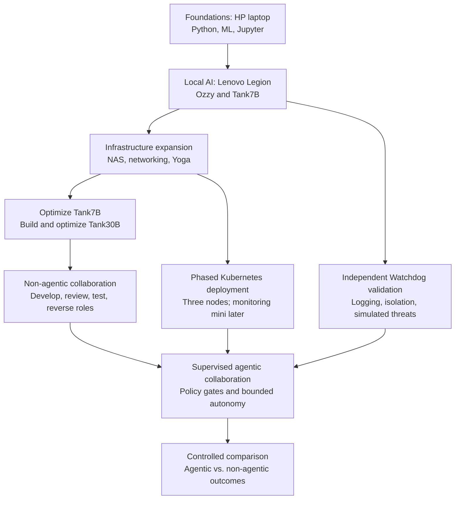

# My Personal AI Infrastructure Lab

**Foundation and Evolution | A living engineering project**

This repository documents my hands-on journey in artificial intelligence, machine learning, Linux, networking, security, and infrastructure engineering. The goal is not simply to accumulate hardware: it is to build, understand, measure, and improve a locally operated AI environment, one validated stage at a time.

The lab began with Python coursework and Jupyter notebooks on an HP laptop. As the experiments outgrew that machine, I moved to a Lenovo Legion to develop local AI assistants and coding models. The next steps bring shared storage, more capable model hardware, independent security monitoring, and eventually Kubernetes orchestration.

The repository is a **living record**, not a claim that the entire system is finished. It documents why each change was made, what was tested, what failed, and what comes next.

## Engineering Principles

1. **Optimize before adding autonomy.** Establish reliable model baselines before introducing agentic workflows.
2. **Prove security boundaries.** Test monitoring, containment, and shutdown rather than assuming they work.
3. **Measure improvements.** Compare models and workflows using repeatable tasks and recorded results.
4. **Scale when justified.** Add hardware and orchestration capabilities incrementally as requirements and budget allow.
5. **Preserve the learning trail.** Record experiments, corrections, and design tradeoffs alongside successes.

## Development Roadmap

The diagram shows the intended dependencies. Some activities, especially Watchdog testing and infrastructure preparation, proceed in parallel.

### Status Snapshot — October 2026

| Workstream | Status | Next evidence or milestone |
|---|---|---|
| HP learning environment | Completed foundation; repurposed | Continue Linux/monitoring practice |
| Legion / Ozzy / Tank7B | Working local development environment | Further optimization and documented evaluations |
| UGREEN NAS and 2.5 GbE network | Initial deployment | Storage, networking, and recovery tests |
| Lenovo Yoga RTX Spark | Ordered / awaiting delivery | Set up and evaluate larger models |
| Tank7B Watchdog | Near completion; heartbeat shutdown tested | Verify persistent failure logs and isolation |
| Tank30B | Planned | Build, optimize, and benchmark |
| Kubernetes mini-PC cluster | Planned; hardware acquisition phased | Establish and validate initial three-node cluster |
| Dedicated security/monitoring mini | Potential later expansion | Compare reliability with HP laptop monitoring |
| Non-agentic model collaboration | Planned | Run controlled role-swap evaluations |
| Agentic orchestration | Future phase | Repeat comparable evaluations under supervision |

## Infrastructure: From Laptop to Mini Data Center

### Phase 1 — HP Laptop: Learning Foundation

My initial HP laptop supported Python programming, machine learning fundamentals, Jupyter notebooks, and early model experiments. It remains useful as a Windows/WSL Ubuntu system for Linux practice, health monitoring, and initial Watchdog hosting tests.

### Phase 2 — Lenovo Legion: Local Model Development

- AMD Ryzen 7 processor
- NVIDIA RTX 5060 GPU
- 48 GB RAM
- Docker, local model runtimes, Jupyter, and SearXNG

The Legion remains the primary development and optimization machine for Tank7B, along with work on Ozzy, coding experiments, retrieval, and security tooling.

### Phase 3 — Storage, Networking, and Larger-Model Hardware

**Lenovo Yoga RTX Spark (ordered):** NVIDIA RTX Spark GPU, 64 GB LPDDR5X RAM, 1 TB SSD, Windows ARM64. Intended for larger-model development and controlled comparisons with Tank7B.

**UGREEN NASync 4800:** Four-bay NAS with two 8 TB Seagate IronWolf drives in a mirrored configuration. Intended as shared storage for lab assets, models, and project files. Future possibilities include RAM, NVMe cache, and network upgrades.

**Networking:** 2.5 GbE switching, shared storage access, Cat 6 cabling, and UPS protection. An eight-port switch is part of the expansion plan.

### Phase 4 — Kubernetes and Independent Monitoring

The initial target is a **three-mini Kubernetes cluster**: one control-plane node and two worker nodes. Planned exercises include scheduling, service recovery, node failures, monitoring, and workload distribution. Nodes can be added as funds and use cases justify them.

Security supervision is intentionally **outside the Kubernetes cluster**. The first option is the existing HP laptop running WSL Ubuntu with sleep disabled. A later dedicated Ubuntu mini may host multiple isolated Watchdog services and a lightweight, read-only health dashboard.

A separate machine alone is not a security guarantee. Watchdog must have independent credentials, narrowly scoped control of supervised workloads, protected logs, and a tested shutdown path. Each Tank host must fail closed if Watchdog becomes unavailable.

## Local AI Projects

### [Ozzy — Local AI Assistant](https://github.com/curriemark63-byte/Ozzy_Project)

A local-first assistant built around a Mistral 7B model, retrieval-augmented answers, and self-hosted SearXNG search. Ozzy established practical experience with local inference, retrieval, Docker, and debugging.

### [Tank — Local Coding Assistant](https://github.com/curriemark63-byte/Tank_Coding_Agent)

Tank7B uses Qwen 2.5 Coder 7B through Ollama. It currently supports **Code**, **Teach**, and **Engineering** modes, along with self-hosted technical search. Published experiments include prime-number coding, sensor drift, anomaly detection, and power-monitoring exercises.

**Tank is not yet an autonomous agent.** Its model performance and security foundations are being developed and tested before an agentic layer is added.

### Twin — Professional AI Assistant

**Planned.** A separate, professional-oriented assistant for technical research and infrastructure workflows.

## Model Optimization Before Autonomy

The revised development sequence is deliberate:

1. Finish and benchmark Tank7B optimization.
2. Build and optimize Tank30B on suitable hardware.
3. Benchmark each model independently with consistent tasks and recorded resource use.
4. Test collaborative **non-agentic** workflows: Tank7B develops and Tank30B reviews, then reverse the roles. Human prompts initiate and manage each step.
5. Only after security validation, add bounded agentic orchestration and repeat comparable tasks.

Separating these stages makes it easier to identify whether an observed improvement or failure comes from the model, the tooling, the orchestration layer, or the infrastructure.

## Independent Watchdog Security

Watchdog is a separate security and monitoring project, not an agentic feature inside Tank.

**Demonstrated:** A Tank container shut down when the Watchdog heartbeat stopped.

**Still to validate:** Reliable and persistent logging of failures, timestamps, reasons, and shutdown actions; monitoring across machines; and resistance to bypass attempts.

**Planned controlled simulations:** Restricted-file access, unauthorized tool requests, resource overuse, interrupted heartbeats, and attempts to interfere with supervision. These tests will run in isolated environments before any autonomous agent is enabled.

The goal is a **reusable Watchdog backbone** with separately deployed instances, configurations, permissions, and thresholds for Tank7B and Tank30B. Tank30B may have more capable reasoning and broader tools, so its permissions and tests will reflect that larger capability surface. The same baseline security tests should apply to both models.

Security evaluation will track both unauthorized actions that slip through **and** legitimate work incorrectly blocked. Least privilege should protect the lab without preventing approved tasks.

## Measuring the Value of Agentic Collaboration

The lab will compare two workflows using comparable development tasks:

| Non-agentic baseline | Supervised agentic experiment |
|---|---|
| Models generate, review, and revise under step-by-step human direction | Agents coordinate bounded steps after a defined assignment |
| Human initiates role changes and retests | Orchestrator schedules reviews, retests, and role reversal |
| Manual checkpoints and recorded outputs | Permission gates, Watchdog enforcement, and audit trails |

Both approaches will be measured for task correctness, test pass rate, elapsed time, compute/memory use, human interventions, security events, and reproducibility. Iteration limits, permitted tools, and resource budgets will be documented.

The question is not whether agentic systems are more impressive. It is **whether autonomy produces measurable value that justifies its added complexity and risk**.

## Future Experiments

- Data-center power anomaly detection and sensor drift
- Predictive maintenance and infrastructure reliability
- Container recovery and Kubernetes failure simulations
- Aerospace-related machine learning using appropriate non-proprietary or synthetic data
- More specialized local assistants and supervised agent workflows

## Professional Development

I bring more than 20 years of electromechanical testing experience to this project. My aim is to combine hands-on testing discipline with practical AI development, Linux administration, networking, and infrastructure engineering.

This lab supports learning relevant to data-center operations, predictive maintenance, and aerospace technology. Every stage is an opportunity to document a requirement, design a test, collect evidence, and improve the system.

---

**Project philosophy:** Build the foundation, validate the behavior, measure the results, and expand deliberately. This is the beginning of an evolving engineering record.
